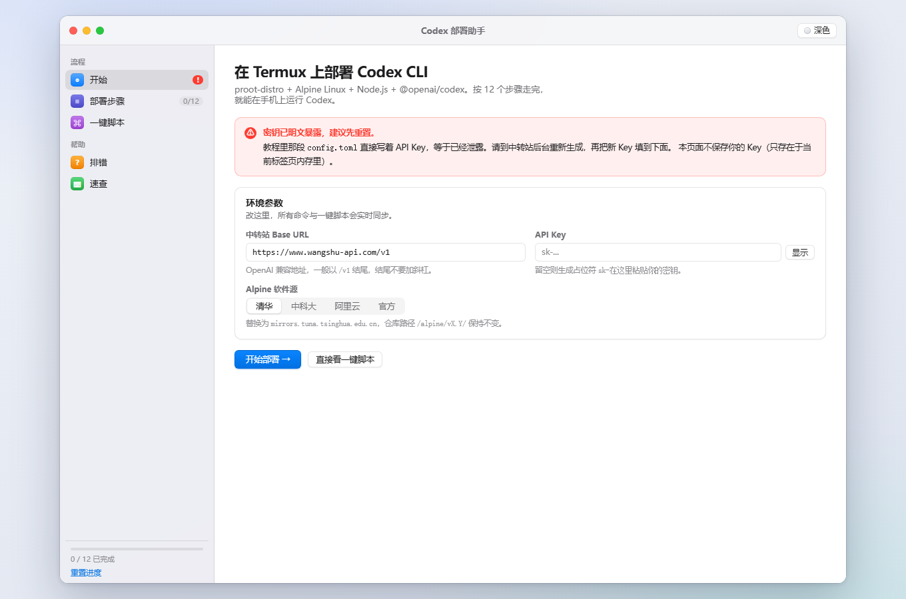
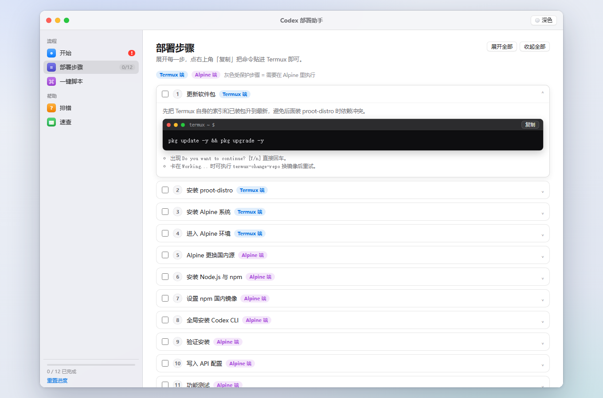
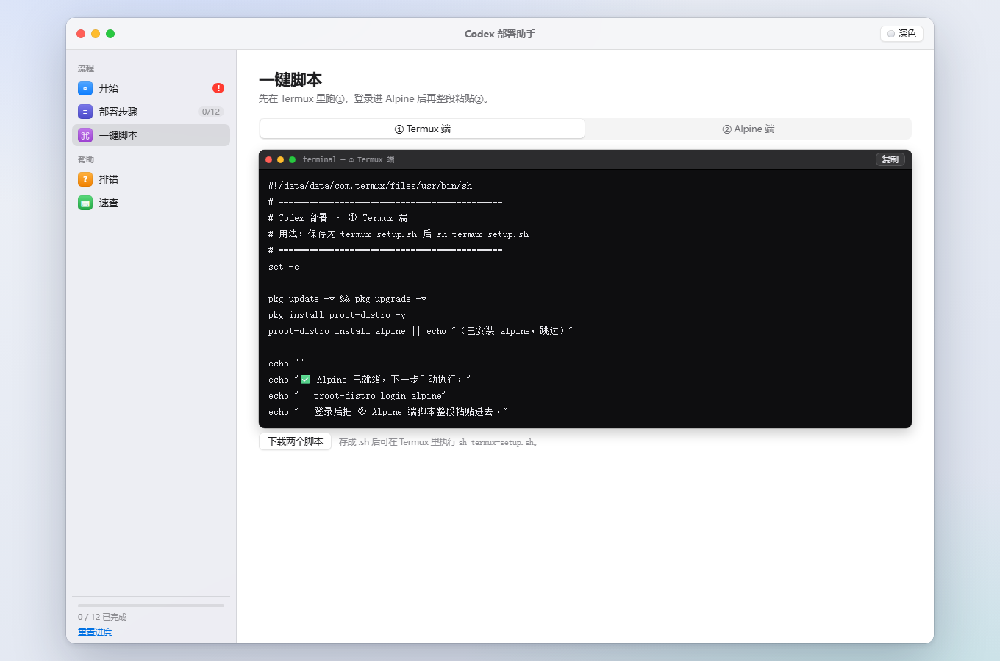

<div align="center">

# Codex 部署助手

**macOS 风格的可视化部署向导 —— 在安卓手机上用 Termux 从零装好 Codex CLI**

[](LICENSE)
[](index.html)
[](.github/workflows/pages.yml)
[](CONTRIBUTING.md)

[在线 Demo](https://YOUR-NAME.github.io/codex-deploy-guide/) · [快速开始](#快速开始) · [反馈问题](../../issues)



</div>

---

## 这是什么

把「Termux → proot-distro → Alpine → Node.js → Codex CLI」这条纯命令行链路，做成一个仿
macOS「系统设置」窗口的单页应用：左边导航、右边步骤，命令块都带复制按钮，改一次参数全局同步。

- **零依赖**：一个 `index.html` + 一个 CSS + 一个 JS，没有构建、没有 npm、不联网、不上报。
- **手机友好**：窄屏自动把侧边栏收成顶部标签，适合对着 Termux 边看边敲。
- **不容易卡住**：12 步都标注了「本步在哪个端执行」，并给出常见报错的处理办法。
- **深色模式**：跟随标题栏按钮切换，配色沿用 macOS 的语义色。

## 截图

| 部署步骤 | 一键脚本 |
| :---: | :---: |
|  |  |

## 快速开始

### 本地打开

```bash
git clone https://github.com/<your-name>/codex-deploy-guide.git
cd codex-deploy-guide

# 方式一：直接双击 index.html
# 方式二：起一个静态服务器
python -m http.server 8000     # → http://localhost:8000
```

### 在手机上打开

把仓库打包下载成 zip，解压后用手机浏览器打开 `index.html`；或者直接访问下面的 Pages 地址。

### 部署到自己的 GitHub Pages

1. 新建仓库，把本目录推上去（默认分支 `main`）；
2. 仓库 **Settings → Pages → Build and deployment → Source** 选择 **GitHub Actions**；
3. 之后每次 push，[`.github/workflows/pages.yml`](.github/workflows/pages.yml) 会自动构建并发布。

## 页面结构

| 侧边栏 | 内容 |
| --- | --- |
| 开始 | 密钥安全提醒 · 中转站 Base URL / API Key 输入 · Alpine 镜像源切换 |
| 部署步骤 | 12 步时间线：终端风命令块、复制、勾选完成、提示、展开/收起全部 |
| 一键脚本 | ① Termux 端 ② Alpine 端，可复制或下载为 `.sh` |
| 排错 | command not found、请求超时、bubblewrap 警告、下载失败、重复部署 |
| 速查 | 登录 / 退出 / 备份 / 重装等常用命令 |

## 联动逻辑

- 改 **Base URL / API Key** → 第 10 步的 `config.toml` 与「一键脚本」实时重写；
- 切 **清华 / 中科大 / 阿里云 / 官方** → 第 5 步换源 `sed` 与脚本里的换源行同步改写（官方源不再生成 `sed`）；
- 勾选步骤 → 侧边栏进度条与 `0/12` 徽标联动，并自动展开下一步；
- 进度、展开态、镜像源、Base URL、主题存 `localStorage`；**API Key 不落盘**，只存在当前标签页内存。

## 自定义默认值

`app.js` 顶部集中放着可调常量，改完刷新即可：

```js
var DEFAULT_BASE_URL = 'https://www.wangshu-api.com/v1'; // 默认中转站，换自己的就改这里
var MIRRORS = [ /* 清华 / 中科大 / 阿里云 / 官方 */ ];
```

- 步骤内容：`getSteps()` 返回的数组（`id / stage / title / desc / term / code / tips`，可选 `extra`）；
- 排错条目：`getFaq()`；
- 速查表：`index.html` 里的 `<table>`；
- 配色 / 圆角 / 阴影：`styles.css` 顶部的 CSS 变量（深色模式是 `body.dark` 覆盖）。

## 目录结构

```
codex-deploy-guide/
├── index.html                 结构：窗口外壳 + 侧边栏 + 5 个视图
├── styles.css                 macOS 风样式（CSS 变量，浅色 / 深色）
├── app.js                     步骤数据、脚本生成、全部交互（原生 JS）
├── favicon.svg                图标
├── docs/screenshots/          README 用的截图
├── .github/
│   ├── workflows/pages.yml    推送到 main 自动发布 GitHub Pages
│   └── ISSUE_TEMPLATE/        问题反馈模板
├── CONTRIBUTING.md            贡献指南
├── SECURITY.md                密钥处理与安全说明
├── LICENSE                    MIT
└── README.md
```

## 安全说明

原教程里的 `config.toml` 把中转站 Key 明文写在 `openai_api_key`，等同于已经泄露。
本页面的处理方式是：

- 页面上只放占位符 `sk-...`，**真实 Key 不会被写进仓库任何文件**；
- Key 输入框是 `password` 类型，只存在于当前标签页内存，不写入 `localStorage`；
- 页面生成的结果需要你手动复制到 Termux，页面本身不发起任何网络请求；
- 页面顶部保留了「密钥可能已泄露」的提醒，并给出改用环境变量 / `env_key` 的写法。

> 第一次用请到中转站后台**重新生成 Key**，别用教程里那串。

## 说明与限制

- 页面只负责生成和复制文本，**不执行任何命令**，实际部署仍需在 Termux 里手动执行。
- `proot-distro login alpine` 是交互式会话，所以「一键脚本」拆成两段（Termux 端 / Alpine 端），而不是一个大脚本。
- 第 10 步默认按原教程的 `openai_base_url` / `openai_api_key` 写法生成，同时提供官方
  `model_provider` + `[model_providers.*]` + `env_key` 写法作为备选，两种都能直接复制。
- 镜像源 / 中转站域名都可能变化，若某条命令 404，请先换成「官方源」再试。

## 参与贡献

欢迎 PR：改命令、补充排错、优化样式都行，规则见 [CONTRIBUTING.md](CONTRIBUTING.md)。
发现安全问题时请用 GitHub 的私密漏洞报告，别开公开 issue。

## License

[MIT](LICENSE) © 2026 Codex Deploy Guide contributors

---

## English

A zero-dependency, single-page visual guide (macOS System Settings style) for installing
**Codex CLI** on Android via **Termux → proot-distro → Alpine → Node.js**.

Open `index.html` in any modern browser — no build step, no network calls, no tracking.
Twelve copy-paste steps, Alpine mirror switching, generated `config.toml`, and two one-shot
shell scripts (Termux side / Alpine side). Progress and theme are stored in `localStorage`;
the API key you type is kept in memory only and is never persisted.

Deploy to GitHub Pages automatically with the included workflow. Licensed under MIT.

